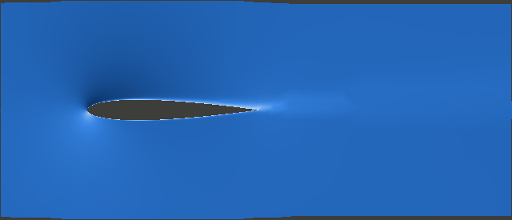

# SenSym WindLab — a virtual wind tunnel for engineering students

> **Educational simulation — results may be inaccurate.** WindLab is an uncalibrated prototype:
> use its numbers to learn and compare, not to design, build or fly real hardware. Read
> [DISCLAIMER.md](DISCLAIMER.md) before you use it; the app asks you to accept it on first start.

WindLab puts a part in a virtual wind tunnel on your own computer. Make a NACA wing, pick a
built-in body, or upload a part exported from SolidWorks (STEP or STL); choose an airspeed and an
angle of attack; and WindLab meshes the part, runs the open-source OpenFOAM® flow solver and shows:

- the **lift and drag coefficients** C<sub>L</sub>, C<sub>D</sub> and the lift-to-drag ratio, with the
  forces in newtons, the range where the true value most likely lies, and how they settle while the
  solver works;
- a **3D picture of the pressure** on the part and a **side view of the flow** (air speed or pressure,
  with streamlines) through the middle of the part;
- **angle sweeps** (C<sub>L</sub> against angle, drag polar, L/D), **Compare** for 2–5 runs, **CSV
  downloads**, a **printable report** (HTML, save as PDF) and the complete **OpenFOAM case** of any run;
- an **instant 2D airflow preview** drawn in the browser while you change the angle, **five guided
  lessons** (50 minutes each, with pre-computed results), a **glossary** behind every (?) and a
  two-minute **tour**.

Everything runs on your computer, inside Ubuntu Linux (WSL2 on Windows, Docker on macOS); the
interface is a page in your normal browser at `http://localhost:8080`. No accounts, no cloud,
nothing is uploaded anywhere. All components are open source.



*The flow through the middle of the default NACA 0012 wing (chord 0.3 m, span 0.6 m, 20 m/s, 10°,
Quick mesh): light = slow air, dark = fast air; the dark grey shape is the wing. The second picture
in [docs/screenshots/](docs/screenshots/) shows the pressure coefficient in the same cut.*

## Quick start

Full instructions for every operating system, with expected output, times and troubleshooting:
**[docs/INSTALL.md](docs/INSTALL.md)**. In short:

**Windows 10/11** (admin rights, 16 GB of memory, about 30–45 minutes, mostly downloads)

```powershell
wsl --install -d Ubuntu-24.04      # in an administrator PowerShell, then restart and create a Linux user
```

```bash
# in the Ubuntu window:
git clone https://github.com/isac-artzi/SenSym-Windtunnel.git windlab
bash windlab/scripts/install_wsl.sh
windlab start                      # then open http://localhost:8080/ in your Windows browser
```

**macOS** (Apple Silicon or Intel; [Docker Desktop](https://www.docker.com/products/docker-desktop/) installed, 8 GB given to it)

```bash
git clone https://github.com/isac-artzi/SenSym-Windtunnel.git
cd SenSym-Windtunnel
scripts/run_docker.sh              # builds the image once (15–25 min), then open http://localhost:8080/
```

**Linux** (Ubuntu 24.04; 22.04 with Python 3.12; other distributions: use the Docker route above)

```bash
git clone https://github.com/isac-artzi/SenSym-Windtunnel.git windlab
bash windlab/scripts/install_linux.sh
windlab start                      # then open http://localhost:8080/
```

No git? Use **Code → Download ZIP** on GitHub, unpack it, and run the same script from the unpacked
folder. `windlab doctor` checks an installation (about 30 s); `windlab update` fetches the newest
version; `windlab start --help` lists the options (port, cores, data folder).

**First run:** press **Make this wing** (NACA 0012), set 20 m/s and 8°, press **Run the wind tunnel**.
Expect C<sub>L</sub> ≈ 0.36 and C<sub>D</sub> ≈ 0.04 after 20–60 s on a fast desktop, 1–3 minutes on a laptop.

## Online demo (limited, no install)

**https://isac-artzi.github.io/SenSym-Windtunnel/** is a **limited online demo, not the WindLab
simulator**. It runs in any browser with nothing to install, but it **cannot run a simulation** and
**cannot take your own parts**. What it does:

- the **instant airflow preview**: a rough 2D sketch drawn in your browser, not a simulation result;
- the **five lessons**, showing results the WindLab team computed in advance with the full app;
- the glossary, the tour and the same educational-use notice as the app.

Use it for a first look, or to follow the lessons if your laptop cannot run the full app. To simulate
your own shapes, install WindLab (above). Nothing you type in the demo is sent anywhere. (It is built
by `scripts/build_static_demo.py` and published by `.github/workflows/pages.yml`; to try it locally:
`python scripts/build_static_demo.py --out site --check`, then
`python -m http.server 8081 --directory site`.)

## Documentation

| Document | For |
|---|---|
| [docs/INSTALL.md](docs/INSTALL.md) | Installing on Windows (WSL2), macOS (Docker) and Linux; verifying; updating; troubleshooting |
| [docs/STUDENT_HANDOUT.md](docs/STUDENT_HANDOUT.md) | One page for students: install, first run, uploading a SolidWorks part, feedback |
| [docs/TEACHING_NOTES.md](docs/TEACHING_NOTES.md) | Instructors: what the numbers mean, expected values, limitations, in-class exercises |
| [docs/lessons/](docs/lessons/README.md) | Printable worksheets and instructor guides for the five guided lessons |
| [docs/GLOSSARY.md](docs/GLOSSARY.md) | Every term the page uses, in plain words |
| [docs/PREVIEW.md](docs/PREVIEW.md) | The instant 2D preview: what it computes and what it cannot tell you |
| [docs/FEEDBACK_SURVEY.md](docs/FEEDBACK_SURVEY.md) | A printable student survey for a class trial |
| [docs/ACCESSIBILITY.md](docs/ACCESSIBILITY.md), [docs/I18N.md](docs/I18N.md) | Accessibility checklist; how the page's text is prepared for translation |
| [validation/](validation/) | The evidence behind the numbers (see the summary below) |
| [dev/README.md](dev/README.md) | Running WindLab or a development shell in Docker |
| [CONTRIBUTING.md](CONTRIBUTING.md) | How to report problems and propose changes |

## How trustworthy are the numbers? (validation summary)

WindLab is **not validated for design**. What has been checked, all with this repository's own runs:

- **The 2D solver chain** against NASA's NACA 0012 reference (Turbulence Modeling Resource, k-ω SST,
  Re 6·10⁶): at 10° C<sub>L</sub> is 1.9 % low and C<sub>D</sub> 0.3 % high against the mean of CFL3D and
  FUN3D ([validation/naca0012_tmr.md](validation/naca0012_tmr.md)).
- **The everyday 3D Quick mesh** (≈ 0.4 million cells) on the default wing: lift within 1–2 % of finer
  meshes, drag 8–9 % above the mesh-converged value and about a third above the 2D section at the same
  Reynolds number ([validation/wing3d_mesh_study.md](validation/wing3d_mesh_study.md)). Treat
  C<sub>D</sub> as an upper estimate and L/D as a lower one; compare runs on the same mesh with each other.
- **Built-in bodies** against handbook drag coefficients: plate and cube agree, the teardrop lands in the
  handbook range, the sphere misses by half (the model assumes a turbulent boundary layer), the
  cylinder's wake never settles ([validation/bluff_bodies.md](validation/bluff_bodies.md)).
- **Ten student-like STEP parts** all mesh and solve; thin fins and plates get an automatic refinement
  band ([validation/robustness.md](validation/robustness.md)).
- Run times and the effect of mesh reuse and warm starts: [validation/performance.md](validation/performance.md).

Every C<sub>L</sub> and C<sub>D</sub> on the page carries a "likely … to …" range from a versioned table
built from this evidence; outside the checked shapes, Reynolds numbers and angles it says
"Unvalidated — treat as a trend only". Known limits: steady, incompressible, fully turbulent RANS
(1–100 m/s, no transition, stall uncertain); one closed solid per part; one run at a time.

## Licence and disclaimer

WindLab is open-source software by SenSym LLC under the **MIT License** ([LICENSE](LICENSE)): you may
use, copy, change and share it; it is provided "as is", **without warranty of any kind**.

WindLab is an **educational simulation**. Its results are approximate and **may be inaccurate**; it is
not validated for engineering design, certification or safety-critical decisions.
**SenSym LLC assumes no responsibility for any damages or injury caused by objects built using this simulator.**
You are responsible for independent verification (physical testing, a qualified engineer) before
building or flying anything. The full notice is [DISCLAIMER.md](DISCLAIMER.md); the app, the command line and
every report, CSV file and export repeat it.

## Reporting problems

Use [GitHub Issues](https://github.com/isac-artzi/SenSym-Windtunnel/issues) with the **Bug report**
template: your operating system and install route, what you did, the exact message, and the output of
`windlab doctor`. See [CONTRIBUTING.md](CONTRIBUTING.md) for pull requests.

## For developers

- Code: `windlab/case_builder.py` (case templates, all numbers clamped), `windlab/runner.py` (OpenFOAM
  stages, stop rule, sweeps, cancel), `windlab/app/` (FastAPI backend and the single-page front end, no
  build step), `windlab/templates/` (OpenFOAM case templates), `windlab/geometry/` (NACA generator,
  built-in bodies, STL/STEP import in a resource-limited worker, orientation, reference areas, thin
  features), `windlab/expected_error.py` + `windlab/validation_table.json` (the likely ranges),
  `windlab/disclaimer.py` (the educational-use notice: page, command line, footers), `windlab/lessons/`
  and `windlab/glossary.json` (content), `scripts/` (validation, mesh study, robustness corpus, the
  static demo, the installers).
- Tests: `pytest -q` (fast, fake solver; the page scripts run headless in Node), `pytest -m slow`
  (the real OpenFOAM run, about a minute); lint with `ruff check .`. Docker development shell:
  [dev/README.md](dev/README.md).
- Security: the server binds to 127.0.0.1, accepts no OpenFOAM dictionaries or scripts, generates every
  case file from templates with clamped numbers, uses server-made ids, and checks uploads in a
  resource-limited subprocess.

## Trade marks and third-party software

OPENFOAM® is a registered trade mark of OpenCFD Limited, producer and distributor of the OpenFOAM
software via www.openfoam.com. This offering is not approved or endorsed by OpenCFD Limited, producer
and distributor of the OpenFOAM software via www.openfoam.com, and owner of the OPENFOAM® and OpenCFD®
trade marks. OpenFOAM is distributed under the GNU GPL v3. WindLab runs it as separate programs (it
writes their input files and reads their output) and contains no OpenFOAM code; WindLab's name does
not include "OpenFOAM". The other components and their licences are listed in the app's "About
WindLab" panel and at the end of every report: OpenCASCADE Technology (LGPL-2.1 with exception,
optional, for STEP files), NumPy (BSD), FastAPI / Starlette / Pydantic / Uvicorn (MIT / BSD), three.js
(MIT), the viridis colour map (CC0) and ColorBrewer (Apache 2.0).
